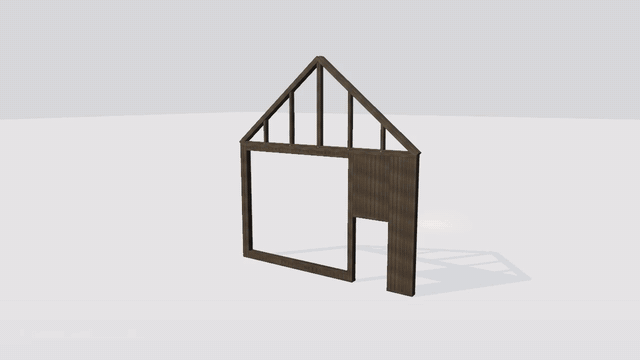
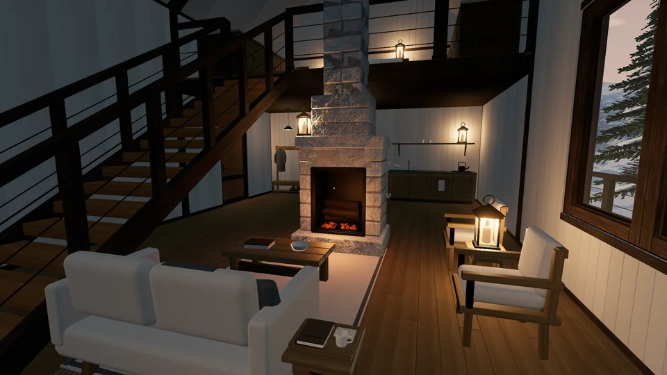
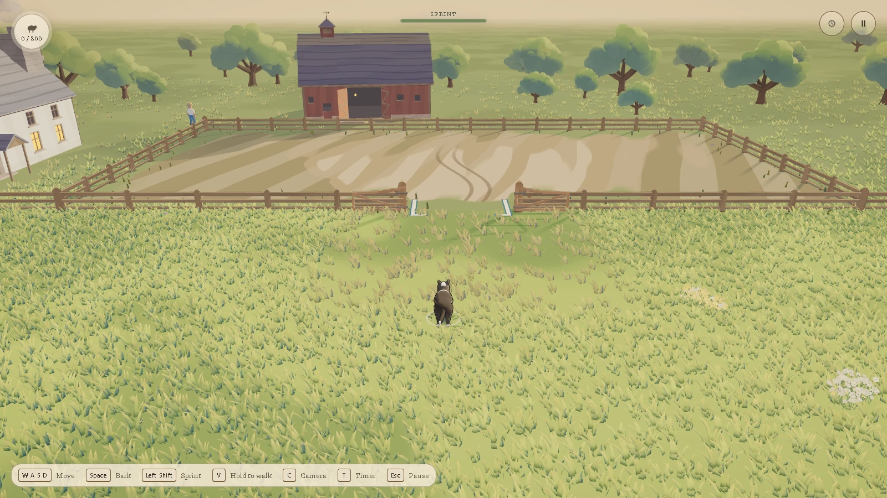
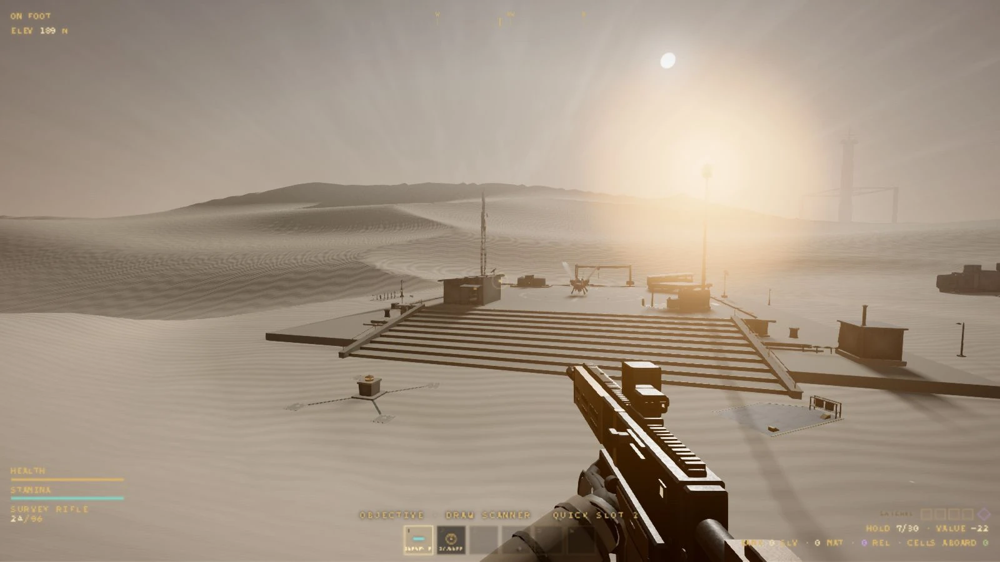
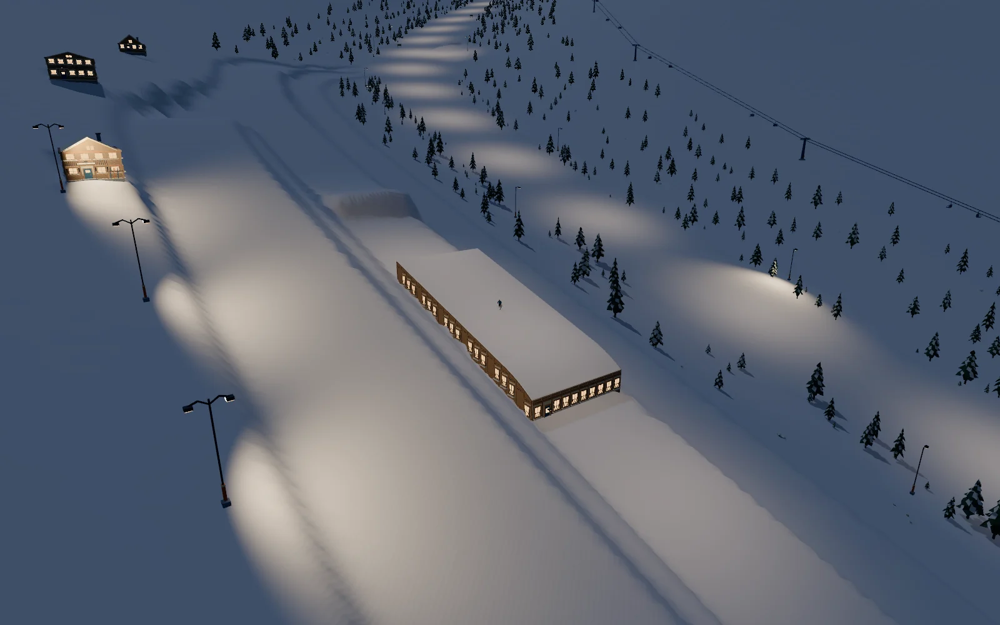

# Kiln

[](https://github.com/instruktlabs/kiln/actions/workflows/ci.yml)
[](https://www.npmjs.com/package/@instruktlabs/kiln)
[](LICENSE)
[](https://discord.gg/fSWVbMdQXK)

**Build and revise 3D assets with your coding agent.**

Your agent writes JavaScript using Kiln's geometry and material helpers. Kiln runs
the program, returns rendered views and structural checks, and exports a GLB.
Keep the editable source to refine the asset later.

Kiln runs locally through MCP, the CLI or a JavaScript/TypeScript SDK. It is free,
open source and account-free. Your coding agent supplies the model; Kiln's tools
do not require a separate model API key.

[Documentation](https://kilnstudio.tools/docs/install/) ·
[Gallery](https://kilnstudio.tools/gallery/) ·
[Interactive scenes](https://kilnstudio.tools/scenes/) ·
[Changelog](CHANGELOG.md)

## From asset to scene

One timber wall becomes part of a modular cabin kit. Assemble its floors, walls
and roof, furnish the kitchen and living room, then build the staircase, sleeping loft, bed and desk.
The finished Winter Mountainside Cabin sits in a snowy Holodeck world.

[](https://kilnstudio.tools/#workflow)

The assembly visualizes the saved Kiln modules; the final view is captured in
Holodeck. Both use WebGPU rendering.

## Explore worlds made with Kiln

Walk these scenes on [Holodeck](https://holodeck.kilnstudio.tools/), then inspect
or remix the Kiln assets they use. Holodeck provides the world runtime; Kiln provides
editable asset source and GLBs.

| Meridian Sanctuary | Crescent Cove | Winter Mountainside Cabin |
| --- | --- | --- |
| [](https://holodeck.kilnstudio.tools/worlds/meridian-sanctuary/) | [](https://holodeck.kilnstudio.tools/worlds/crescent-cove/) | [](https://holodeck.kilnstudio.tools/worlds/winter-mountainside-cabin/) |

- **[Meridian Sanctuary](https://holodeck.kilnstudio.tools/worlds/meridian-sanctuary/):** marble arcades, mirror pools and floating sculpture. [53 assets and editable source](https://kilnstudio.tools/packs/holodeck/meridian-sanctuary/).
- **[Crescent Cove](https://holodeck.kilnstudio.tools/worlds/crescent-cove/):** tropical planting, coastal rock formations and a beach shelter. [49 assets and editable source](https://kilnstudio.tools/packs/holodeck/crescent-cove/).
- **[Winter Mountainside Cabin](https://holodeck.kilnstudio.tools/worlds/winter-mountainside-cabin/):** timber architecture, a furnished interior and snowy forest. [56 assets and editable source](https://kilnstudio.tools/packs/holodeck/winter-mountainside-cabin/).

[Explore all scenes](https://kilnstudio.tools/scenes/), including Troy, Farm,
Golden Gate, Foundry Floor and Cabin in the Woods, or
[browse the asset gallery](https://kilnstudio.tools/gallery/).
Scene code and asset content retain their own licences; each pack records its scope.

## Used in live games

I build Sheepdog Sim, OBJEKT-62 and ski sim alongside Kiln, and use these games
to test Kiln-authored assets in real gameplay.

| Sheepdog Sim | OBJEKT-62 | ski sim |
| --- | --- | --- |
| [](https://sheepdogsim.com/) | [](https://objekt62.com/) | [](https://skisim.app/) |

Sheepdog Sim's [source](https://github.com/matthew-kissinger/sds) shows how its
Kiln-authored buildings, fencing and trees fit into a working game. OBJEKT-62 uses
Kiln for weapons, vehicles and outpost modules; ski sim uses it for skiers,
vegetation, village buildings and park equipment.

## Community and hosted access

[Join the Kiln Discord](https://discord.gg/fSWVbMdQXK) to share assets, get help,
and request hosted access. [Hosted Kiln](https://kiln.instruktlabs.com/) is open
as a free, invite-only introductory service, with ten accounts sharing an
allowance of 200 native requests per month. Ask in `#request-access` or message
`matt_941`; individual Kiln codes are sent privately as capacity allows.
Joining Discord does not automatically grant hosted access. Local Kiln remains
free, open source and account-free.

## Install

Use Node.js 22 or 24 LTS and npm. See [supported versions and platforms](docs/install.md)
for the complete compatibility range. Bun is only needed to work on Kiln itself.

```sh
mkdir kiln-install
cd kiln-install
npm init -y
npm install @instruktlabs/kiln
npx --offline --no -- kiln-init ../my-assets --harness codex
cd ../my-assets
```

Open your coding agent in `my-assets` and follow `START.md`. Choose `claude`,
`codex`, `opencode`, `agy`, `hermes`, `copilot` or `cursor-agent` for `--harness`.
Setup creates project-local instructions, skills, launchers and a `kiln_workspace`
MCP connection. Keep this authoring workspace separate from the engine installation.

Then ask your agent for an asset:

> Create a low-poly camping lantern with a carry handle. Review it from several
> angles, refine any problems, and save the editable source and a GLB.

For an **existing project**, Kiln 1.1+ supports a preview followed by adoption:

```sh
# Run from kiln-install; replace the path and harness for your project.
npx --offline --no -- kiln-init /absolute/path/to/my-project --adopt --harness codex --check
npx --offline --no -- kiln-init /absolute/path/to/my-project --adopt --harness codex
```

The preview writes nothing and exits 1 when changes are needed. Adoption preserves
existing instructions and unrelated configuration, and reports conflicts before
overwriting files. See [installation and upgrades](docs/install.md) for version
availability, additional agents, repairs and plugin setup.

## What you can do

| Task | Kiln provides |
| --- | --- |
| Author and refine | Geometry helpers, named parts, immutable source revisions and anchored edits |
| Inspect | Multi-view renders, measurements and image-independent structural QA |
| Save and reuse | A local asset library, revision history and portable source/GLB exports |
| Review together | A local dashboard with materials, optional projects and Live Review |
| Integrate | Shared CLI/MCP tools and compiled ESM with TypeScript declarations |

Projects are optional. A single asset needs no pack, project record or hosted account.
Use [Discovery](docs/tools.md) to find helpers rather than guessing API names.

CPU rendering works without a GPU and is useful for geometry review. Material-faithful
views use the optional local render service; texture and metallic appearance must be
checked against the reported fidelity. See [rendering and materials](docs/rendering.md).
Experimental implicit modeling and the alternative Three.js exporter are opt-in;
their [stability boundaries](docs/sdk.md#stability-in-1x) are documented separately.

## CLI and SDK

The package installs three commands: `kiln`, `kiln-init` and `kiln-mcp`.
For a command available throughout your terminal, install it globally:

```sh
npm install -g @instruktlabs/kiln
kiln discover --capabilities --json
kiln render my-asset.kiln.js --out my-asset.glb --views sheet.png
```

KTX2 texture compression for the three.js runtime export (`export --target three --ktx2`)
uses an optional peer that Kiln does not install or bundle. Add it to the same installation
when you need it: `npm install ktx2-encoder@0.6.0`. It is MIT-licensed and ships its own
notice for the bundled Basis Universal encoder (Apache-2.0); see
[KTX2 textures](docs/export-profiles.md#ktx2-textures).

With a project-local installation, use `npx --no -- kiln discover --capabilities --json`
from that project. The [CLI installation guide](docs/install.md#run-the-cli) covers PATH
and the equivalent `npm exec` command.

Inside a generated authoring workspace, use its launcher to match the MCP server's
Kiln installation, Node version and source store:

```sh
node kiln.mjs discover --capabilities --json
node kiln.mjs render my-asset.kiln.js --out my-asset.glb --views sheet.png
node kiln.mjs view
```

The SDK is available as `@instruktlabs/kiln` and documented subpaths.
Read the [SDK guide](docs/sdk.md) for imports and host interfaces, and the
[tool reference](docs/tools.md) for MCP schemas. Local Claude Code and Codex
[plugins](docs/install.md#local-claude-code-and-codex-plugins) use the same workspace
setup. Other MCP clients can connect directly.

[ChatGPT](docs/chatgpt.md) uses a separate remote-connection setup. A public hosted
Kiln service and vendor directory listings are not available yet.

## Work on Kiln

For engine development, use the [pinned toolchain](toolchain.json):

```sh
git clone --filter=blob:none https://github.com/instruktlabs/kiln
cd kiln
bun install --frozen-lockfile
bun run build:sdk
node scripts/example-archive.mjs --fetch
bun run typecheck
bun run test
```

Read [CONTRIBUTING.md](CONTRIBUTING.md) for the complete checks, package builds and
bug-report guidance, and [AGENTS.md](AGENTS.md) when changing the engine with an agent.
Author assets in a separate workspace. Large scene downloads are optional and are
not fetched by cloning the repository.

Kiln is maintained by [Instrukt Labs](https://github.com/instruktlabs) and released
under the [MIT license](LICENSE). Downloaded asset packs carry their own licenses.
