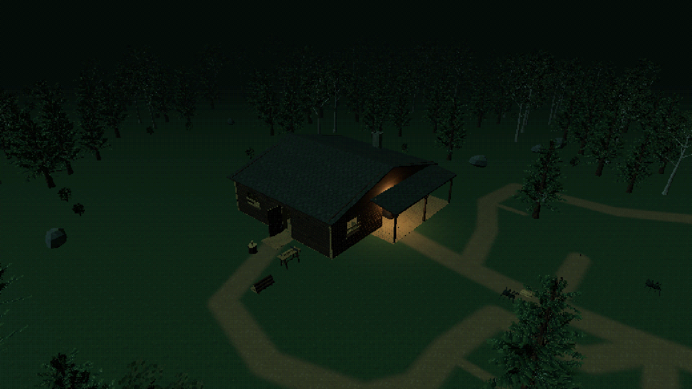
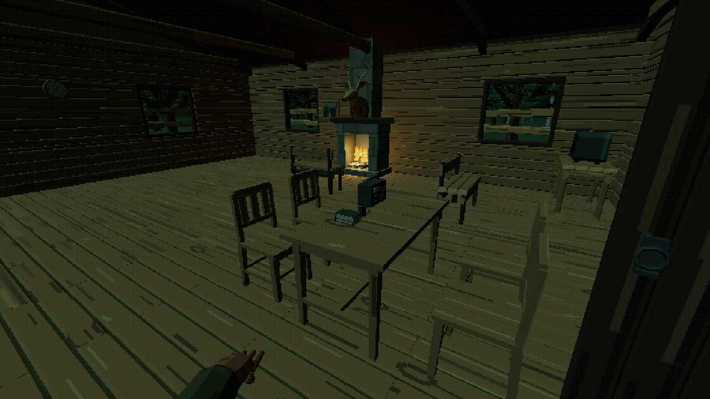

# Cabin in the Woods: PSX Horror

An original PSX asset pack with a furnished modular cabin, outdoor wood-working
stations, pine and birch woodland, rocks, supplies, a Caretaker character,
first-person tools, spiders and a Stone Golem. The accompanying
[R3F and WebGPU scene](../../scenes/packages/cabin-woods-psx-horror/README.md)
demonstrates the assets together.

| Cabin and woodland | Furnished interior |
| --- | --- |
|  |  |

The gallery, pack and scene select the same saved revisions. Runtime assets are
GLBs with metadata. Full Kiln assets are importable saved-revision ZIPs containing
the canonical model, source, preview, editing manifest and complete pinned
material resources. Import a selected revision ZIP into Kiln's Library to remix
it. The aggregate pack ZIP contains those revision ZIPs and a delivery inventory.
Ancestor identifiers remain provenance; only the selected revisions are included.

Lightweight source programs, manifests and material recipes are retained here
after local staging. Generated models, maps, previews and archives remain outside
Git. The release inventory is
`site/src/data/cabin-woods-psx-horror.json`; the manual local stager is
`site/scripts/stage-cabin-woods.mjs`. Staging does not upload or publish anything.
The generic asset hydration command documented in the parent README does not
currently select this pack.

Rebuilding or remixing requires Kiln 1.2.3 or later.
Canonical downloads do not require source rebuilding. Standalone asset use does
not require a Kiln project or the scene's controllers, collision or batching.

The companion scene archive includes a browser build, selected runtime resources,
maintained source, a frozen standalone lockfile and software license notices.
Its source hydration command verifies the exact runtime member seals before
writing asset data. It does not execute downloaded source. Asset licensing is
recorded in the delivery.
